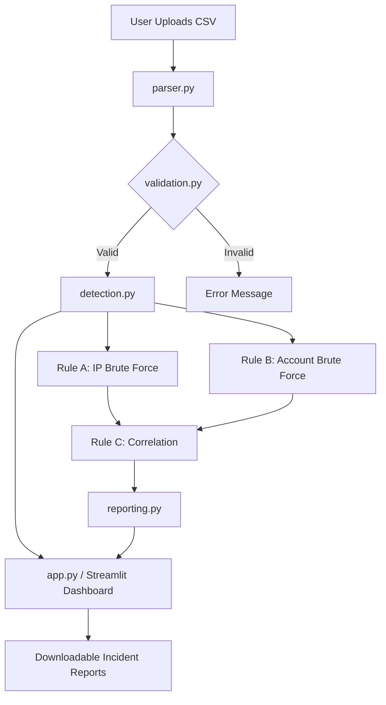

# LogSentry 🛡️
**Windows Security Log Analyzer for Suspicious Activity**

## 1. Project Overview
LogSentry is a local, rule-based cybersecurity tool that analyzes Windows Security Event logs (exported as CSV) to identify potential authentication-based attacks, such as brute-forcing and unauthorized access. It features a polished dashboard for exploring security events and investigating alerts.

This is a defensive cybersecurity portfolio project demonstrating log parsing, data normalization, deterministic detection rules, and incident reporting.

## 2. Problem Statement
Security analysts are often overwhelmed by the sheer volume of Windows authentication logs (Event IDs 4624 and 4625). Attackers use brute-force or credential stuffing techniques that blend in with ordinary failed logins. LogSentry automates the detection of anomalous authentication bursts without relying on external APIs or complex machine learning models.

## 3. Why This is Cybersecurity-Related
LogSentry focuses on the **Detection & Analysis** phase of Incident Response. It specifically targets the identification of suspicious authentication patterns (Tactic: Credential Access, Technique: Brute Force) by analyzing event sequences and correlating them with subsequent successful logins.

## 4. Features
* **Automated Log Parsing:** Reads CSV exports from Windows Event Viewer, handling various column naming conventions and missing fields.
* **Deterministic Detection Engine:** Groups and analyzes failed logins over rolling time windows.
* **Correlation:** Links bursts of failed logins to subsequent successful logins to highlight potential compromises.
* **Interactive Log Explorer:** Allows analysts to filter logs by IP, Account, Event ID, and Time.
* **Incident Reports:** Generates safe, CSV-injection-protected incident reports.
* **Configurable Rules:** Users can adjust thresholds and time windows directly from the UI.
* **Local Processing:** 100% offline analysis. No data is sent to external services.

## 5. Technology Stack
* **Python 3** (Core Logic)
* **Streamlit** (Interactive Dashboard UI)
* **Pandas** (Data Manipulation & Time-Series Analysis)
* **Plotly** (Interactive Data Visualizations)
* **Pytest** (Automated Testing)

## 6. Architecture Diagram



## 7. Windows Security Event IDs Analyzed
* **4624**: An account was successfully logged on.
* **4625**: An account failed to log on.

*Note: While other events like 4688 (Process Creation) can be present in the logs, LogSentry primarily focuses on 4624 and 4625 for its authentication rules.*

## 8. Detection Rules
1. **RULE A (Repeated Failed Logons by Source):** Triggers if a single Source IP generates >= X failed logons (4625) within Y minutes. (Default: 5 failures / 2 mins).
2. **RULE B (Repeated Failures Against Account):** Triggers if a single Account receives >= X failed logons within Y minutes, regardless of the Source IP.
3. **RULE C (Successful Logon Following Failures):** Correlates a burst of failed logons (from Rule A or B) with a successful logon (4624) from the same IP or for the same Account within a configurable correlation window (Default: 10 mins). Marked as **HIGH** severity.

## 9. Example Input Data
The system accepts CSV data in the following normalized format (or similar variations):
```csv
timestamp,event_id,account,source_ip,computer,description
2023-10-27T08:10:00,4625,jdoe,192.0.2.10,SRV-01,Failed logon (bad password)
2023-10-27T08:12:00,4624,jdoe,192.0.2.10,SRV-01,Successful logon
```
See `data/sample_security_logs.csv` for a complete synthetic dataset.

## 10. Example Alert Output
```json
{
  "severity": "HIGH",
  "rule_name": "Successful Logon After Failures",
  "source_ip": "192.0.2.10",
  "account": "jdoe",
  "event_count": 1,
  "first_timestamp": "2023-10-27T08:11:00",
  "last_timestamp": "2023-10-27T08:12:00",
  "reason": "Successful logon correlated within 10 minutes after a burst of failures.",
  "recommendation": "Immediate investigation required. This account may be compromised."
}
```

## 11. Installation Instructions (Windows PowerShell)
Prerequisites: Python 3.11+ must be installed and added to your PATH.

1. Clone or download the repository.
2. Open PowerShell and navigate to the `LogSentry` directory:
   ```powershell
   cd path\to\LogSentry
   ```
3. Create a virtual environment:
   ```powershell
   python -m venv .venv
   ```
4. Activate the virtual environment:
   ```powershell
   .\.venv\Scripts\Activate.ps1
   ```
   *(Note: If you receive an Execution Policy error, you may need to run `Set-ExecutionPolicy -ExecutionPolicy RemoteSigned -Scope CurrentUser` first).*
5. Install dependencies:
   ```powershell
   python -m pip install -r requirements.txt
   ```

## 12. How to Run the Dashboard
Ensure your virtual environment is active, then run:
```powershell
streamlit run app.py
```
A browser window will automatically open to `http://localhost:8501`.

## 13. How to Execute Tests
Ensure your virtual environment is active, then run:
```powershell
python -m pytest -q
```
This executes the automated test suite in `tests/` and validates parsing, detection, and reporting logic.

## 14. How to Export Windows Security Events to CSV
To test with your own data:
1. Open Windows **Event Viewer**.
2. Navigate to **Windows Logs** > **Security**.
3. (Optional) Filter the current log to include only Event IDs 4624 and 4625.
4. Right-click the log/filtered view and select **Save All Events As...** or **Save Filtered Log File As...**
5. Save the file as a **CSV (Comma Separated) (*.csv)** format.
6. Upload this CSV into LogSentry.

## 15. How to Use Synthetic Test Data
A synthetic dataset is provided in `data/sample_security_logs.csv`. 
1. Run the dashboard.
2. Click **Browse files** in the sidebar.
3. Navigate to the `data/` folder and select `sample_security_logs.csv`.
4. Click **Run Analysis**.

## 16. Limitations and False Positives
* **Local Scope:** This is a post-incident analysis tool, not a real-time monitoring SIEM.
* **Missing IPs:** Some Windows log configurations do not record IP addresses for all failed logons. LogSentry degrades gracefully but cannot correlate IP-based brute-force attacks if the IP is missing.
* **False Positives:** A legitimate user forgetting their password 5 times in a row will trigger Rule A. A service account with a desynchronized password attempting to log in continuously will also trigger alerts.

## 17. Security and Privacy Considerations
* **Offline Processing:** No data is sent out of the application. Everything processes in local memory.
* **CSV Injection Protection:** Exported reports sanitize user-controlled fields (like account names) to prevent Excel/CSV injection attacks.
* **Data Sanitization:** The included sample dataset uses RFC 5737 TEST-NET IP addresses and synthetic user data.

## 18. Python Modules Explained
* `app.py`: The entry point for the Streamlit web dashboard.
* `logsentry/parser.py`: Handles CSV ingestion, column normalization, and timestamp parsing.
* `logsentry/detection.py`: Contains the core logic for Rules A, B, and C.
* `logsentry/reporting.py`: Formats the detection alerts and events into safe, downloadable CSV formats.
* `logsentry/validation.py`: Ensures uploaded files meet the minimum requirements before processing.
